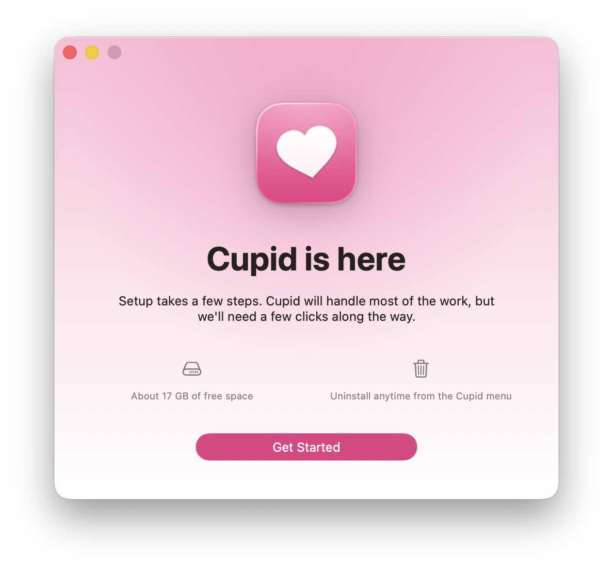

<p align="center"></p>

# Cupid

Cupid is a simple **Heartopia** launcher for Mac. It guides you through installing the game natively for you, and launches it when you
open Cupid. It's that simple.

<p align="center"></p>

## Requirements

- A Mac with Apple silicon (M1 or later)
- macOS 26 or later
- About 17 GB of free space, most of it for Heartopia itself

## Download

1. Go to the [latest release](https://github.com/iminlikewithyou/cupid/releases/latest).
2. Under **Assets**, click the file ending in `.dmg` to download it.
3. Open the downloaded file and drag **Cupid** into the **Applications** folder next to it.
4. Open Cupid from Applications. The first time, macOS says it could not verify Cupid and
   will not open it. Close that message, open **System Settings**, go to **Privacy &
   Security**, scroll down, and click **Open Anyway** next to Cupid. It opens normally from
   then on.
5. Follow the steps in Cupid's window.

## Settings

- Three fullscreen modes: fill the screen with notifications showing (the default), fill the
  screen with notifications hidden, or an own Space like a Mac game.
- A performance overlay.
- Opening Cupid while holding Option opens to the Cupid launcher instead of starting the game.

## How it works

Cupid runs the Windows version of Heartopia in a private Windows environment with its own
build of Wine and DXMT (Direct3D 11 on Metal). No Steam, CrossOver, or Windows license is
involved.

The runtime is built from pinned sources by [`scripts/runtime`](scripts/runtime/README.md):
Wine from CodeWeavers' CrossOver sources, DXMT, and GStreamer and FFmpeg for the game's
videos, plus Apple's Direct3D shared library as shipped by Recall. The build pipeline and the
patches in `patches/recall` come from [Recall](https://github.com/AsherJN/recall) by AsherJN
(Apache License 2.0). Cupid's own Wine patches are in
[`patches/cupid`](patches/cupid/README.md): shareable video textures, a minimal
DispatcherQueue, the game's name and icon in the Dock, and the fullscreen modes.

Licenses for every bundled component are in [docs/THIRD_PARTY.md](docs/THIRD_PARTY.md).
TapTap and Heartopia are downloaded from their publishers and are not part of Cupid.

## Building

Requires Xcode 26. No third-party Swift packages.

```sh
swift build && swift test
scripts/build-app.sh [--dmg]   # build/Cupid.app, ad hoc signed
```

`build-app.sh` needs the runtime archive in `Resources/runtime/`: build it with
`scripts/runtime` and copy `runtime.tar.gz` and `runtime-archive.json` there.
`scripts/fetch-runtime.sh` fetches Recall's prebuilt runtime instead, which lacks Cupid's
patches.

`scripts/release.sh <version>` writes `VERSION`, builds and tests, makes the DMG, its
sha256 and release notes, commits and tags, then prints the push and `gh release` commands
(`--dry-run` skips the commit and tag, `--publish` runs the commands).

The app bundles a command-line tool at `Cupid.app/Contents/Helpers/cupid` with the same
engine; run `cupid --help`.

## License

Apache License 2.0 ([LICENSE](LICENSE)). Bundled components keep their own licenses.
